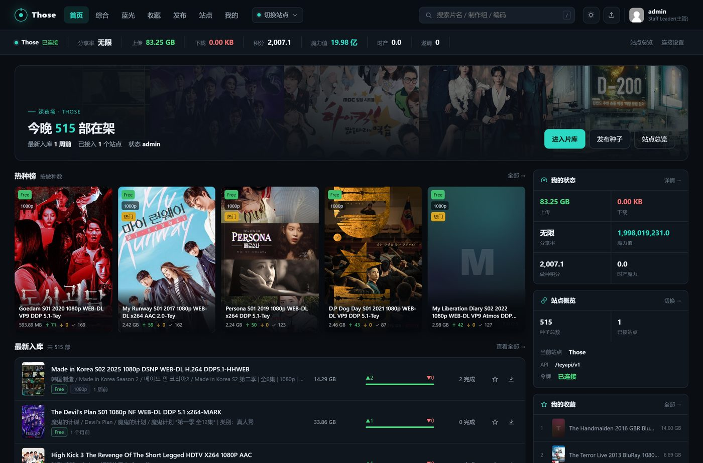

# Those · PT 站前端

面向 NexusPHP（PT 站）API 的纯静态前端：海报墙浏览、种子检索、详情页、收藏与促销标识。零后端，浏览器直连站点 API（每用户独立 Bearer 令牌），可部署成网页、PWA 或飞牛 fnOS 应用。



## 特性

- **海报墙**：响应式卡片流，封面左上角直接标出 `Free / 2X / 50%` 促销徽章与分辨率；悬停展开完整副标题（不截断、可滚动）
- **多站点**：一份前端可服务多个站点，站点之间独立令牌、一键切换
- **跨分区收藏**：普通分区 + 特别区（蓝光/原盘）合并去重，收藏页与首页收藏区数据一致
- **图片三件套**：多级回退（直连 → 自建代理 → 公共代理 → 按片名补图 → 生成式占位），配套 Cloudflare Worker / PHP 两套图片代理，破图床防盗链 + 豆瓣按片名补图
- **深浅主题**：跟随系统或手动切换，配色随主题切换（含悬停浮层）
- **纯静态**：产物只有 HTML/JS/CSS，扔进任意静态站（1Panel / nginx / Cloudflare Pages）即可运行

## 技术栈

Vite 5 · React 18 · TypeScript · React Router 6 · 零后端

## 目录结构

```
api-ui/            前端源码（Vite + React + TS）
  src/lib/config.ts    运行时配置：多站点目录、令牌、图片代理
  src/lib/poster.ts    片名提取与补图地址生成
  src/components/      TorrentCard / Poster / SmartImage 等
deploy/
  api-frontend/      构建脚本与 nginx SPA 配置
  image-proxy/       图片代理：worker.js（Cloudflare）/ img.php（PHP）/ nginx 反代示例
  go-live.sh         一键上线脚本模板
docs/                流程与架构方案、1Panel 部署文档、截图
fnos/                飞牛 fnOS 应用工程（fnpack 打包源）
```

## 本地开发

```bash
cd api-ui
npm install
npm run dev          # http://127.0.0.1:5173
```

本地联调可用 `.env.local`（不要提交）把 API 指到自己的站点：

```
TEY_DEV_API=http://192.168.1.10
TEY_DEV_TOKEN=你的令牌
TEY_DEV_COVER=http://127.0.0.1:8899/img?f=0
```

`vite.config.ts` 里仅在 dev 生效的插件会替换 `/config.js` 并把 `/teyapi` 反代到该 API，生产构建不受影响。

## 构建与部署

```bash
cd api-ui
npm run build        # 产物在 api-ui/dist
```

把 `dist/` 整个目录上传到站点根目录即可。运行时配置写在 `config.js`（不参与构建，改完刷新即生效）：

```js
window.__TEY_API__ = {
  brand: 'Those',
  activeSite: 'those',
  imageMode: 'auto',
  coverProxy: 'https://img.example.com/img?f=0',
  sites: [
    { id: 'those', name: 'Those', apiBase: 'https://example.com/api/v1', color: '#2bd9c4' },
  ],
};
```

> `config.js` 里**不要**放令牌。令牌由每个用户在「连接设置」里自行填入，只存本机 localStorage。

nginx 需要 SPA 路由回退（`try_files $uri $uri/ /index.html;`），参考 `deploy/api-frontend/nginx-spa.conf`。

## 图片代理

图床普遍有防盗链（豆瓣直连返回 418），封面需要一层代理。两种部署方式任选其一：

| 方案 | 文件 | 适用 |
|---|---|---|
| Cloudflare Worker | `deploy/image-proxy/worker.js` | 站点在 Cloudflare 后面，免费额度足够，自带边缘缓存 |
| PHP | `deploy/image-proxy/img.php` | 有 PHP 运行时的服务器，磁盘缓存 7 天 |

接口约定：

- `?u=<url>` 取原图（带 Referer、白名单域名、禁内网、大小上限）
- `?q=<片名>` 按片名到豆瓣搜索补图（子图床取中图，体积小、加载快）
- `?f=0` 取不到时返回 404，前端立即回退下一张，不阻塞渲染

## 飞牛 fnOS 应用

`fnos/` 是可直接用 [fnpack](https://developer.fnnas.com/docs/) 打包的应用工程（docker-project 类型，nginx 容器 + 静态产物）：

```bash
# 1. 先构建前端产物
cd api-ui && npm run build && cd ..

# 2. 复制产物进 fnOS 工程
mkdir -p fnos/app/web && cp -r api-ui/dist/* fnos/app/web/

# 3. 打包（fnpack 从 static2.fnnas.com 下载对应平台版本）
fnpack build -d fnos        # 产出 fnos.fpk
```

安装时应用中心「手动安装」上传 `.fpk` 即可，默认端口 `8790`，安装/升级回调会把静态文件同步到应用数据目录，再由 nginx 容器挂载。

## 说明

- 本项目只是**客户端**，不包含任何站点数据、种子文件或账号；使用时需自备站点 API 令牌。
- 仅供个人学习与自用，请遵守所在站点的规则与当地法律法规。
